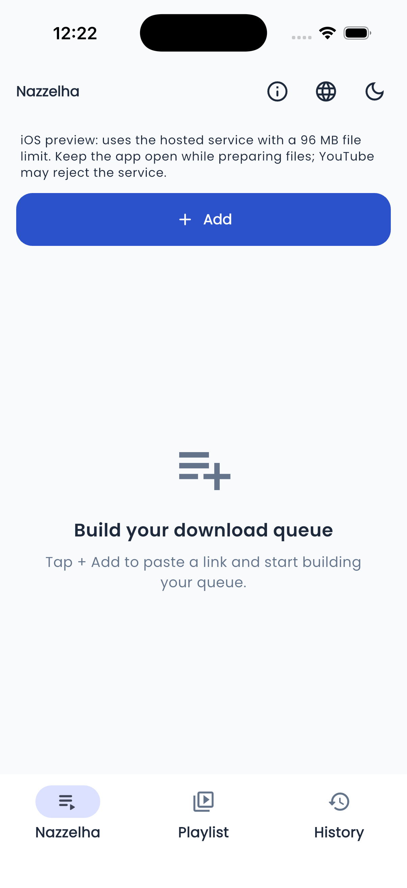

# نسخة iOS التجريبية — التثبيت باستخدام Sideloadly

هذه نسخة Flutter أصلية تستهدف **iOS 15 أو أحدث**، مع واجهة نزلها وحفظ الملفات على الجهاز. ملف `Nazzelha-iOS-Unsigned.ipa` غير موقّع بحساب مطور؛ يحتاج التوقيع بحساب صاحب الجهاز قبل تثبيته. لا يوجد Setup من نوع EXE على iPhone، ولا يتثبت IPA بمجرد فتحه من المتصفح.

البناء والاختبار يستخدمان macOS في [GitHub Actions](https://github.com/MTFOODA/nazzelha/actions/workflows/ios-preview.yml). يوجد أيضًا إعداد `codemagic.yaml` لتشغيل نفس الخطوات على Codemagic. لا تحتاج عملية البناء غير الموقّع إلى حساب Apple أو شهادات توقيع.

## ما الذي تعمل به هذه النسخة؟

- تجهيز الفيديو والصوت يتم من خلال خدمة نزلها المستضافة؛ ثم تُنقل البيانات إلى ملف على iPhone.
- تحفظ النسخة الملفات فعليًا داخل Documents/Nazzelha، وتتحقق من اكتمال عدد البايتات قبل إعلان النجاح.
- المسار في تطبيق Files يكون داخل حاوية Nazzelha، ثم مجلد Nazzelha والمنصة أو مجلد البلايليست المختار.
- زر «فتح أو مشاركة الملفات» يفتح منتقي iOS لتصدير نسخة من الملف أو المجلد إلى وجهة تختارها.
- العربية والإنجليزية والمظهران والسجل والتحكم في العناصر تستخدم واجهة Flutter نفسها.

**قيود مهمة للتجربة:** هذه النسخة لا تحتوي محرك Python/FFmpeg محليًا مثل Android أو Windows؛ حدود خدمة الويب تسري عليها: 96 MiB للملف ونحو 225 ثانية للتجهيز والنقل. قد يمنع YouTube خادم الاستضافة رغم عمل الرابط في Android أو Windows. أبقِ التطبيق مفتوحًا أثناء التجهيز؛ خدمة Android الخلفية ليست متاحة في هذه النسخة من iOS. لا يوجد ضمان لتنزيل كل منصة أو رابط.

## خطوات تجربة صديقك

1. نزّل `Nazzelha-iOS-Unsigned.ipa` من [إصدار iOS التجريبي](https://github.com/MTFOODA/nazzelha/releases/tag/v1.2.0-ios-preview.1). ملف `Nazzelha-iOS-Simulator.zip` للمحاكي على Mac فقط، وليس ملف التثبيت على الهاتف.
2. نزّل [Sideloadly من موقعه الرسمي](https://sideloadly.io/). اتبع متطلبات الموقع لنسخ iTunes وiCloud المناسبة على Windows؛ لا يلزم تثبيت أدوات تطوير Flutter على جهاز التجربة.
3. وصّل iPhone بكابل USB، افتح قفل الهاتف، ووافق على الوثوق بالكمبيوتر عند طلب النظام.
4. افتح Sideloadly، اختر الجهاز، واسحب ملف IPA إلى البرنامج.
5. أدخل حساب Apple المجاني لصاحب الجهاز داخل Sideloadly وأكمل التحقق الذي تطلبه Apple. بيانات الحساب لا تدخل تطبيق نزلها ولا تُرسل في المحادثة.
6. ابدأ التوقيع والتثبيت. اتبع تعليمات iOS للوثوق بالمطور وتفعيل Developer Mode إذا طلبها النظام.
7. افتح نزلها وابدأ بفيديو Facebook عام صغير، ثم راجع الملف داخل Files.

بحسب [توثيق Sideloadly الرسمي](https://sideloadly.io/)، يمكن استخدام حساب Apple مجاني، وتكون صلاحية التوقيع المجاني **7 أيام**، مع إمكانية إعادة التوقيع/التجديد. هذه طريقة اختبار شخصي، وليست نشرًا على App Store أو TestFlight. لا تستخدم خيار تغيير الحد الأدنى للنظام لإجبار التطبيق على إصدار أقدم من iOS 15.

## ما الذي نسجله في تجربة الهاتف؟

| التجربة | النتيجة المطلوب تسجيلها |
| --- | --- |
| التثبيت وفتح التطبيق | موديل iPhone، إصدار iOS، نجاح التوقيع والتشغيل أو رسالة الخطأ الدقيقة. |
| العربية والوضع الداكن | اتجاه النص، ظهور الأزرار، عدم خروج المحتوى عن الشاشة. |
| فيديو عام صغير | اكتمال التنزيل ووجود ملف غير فارغ وفتح الصوت والصورة. |
| مجلد عربي للبلايليست | الاسم في Files يطابق الاسم المختار دون إنشاء مجلد مختلف. |
| الاستئناف والإزالة | المكتمل يبقى محفوظًا، والعنصر المستبعد لا يواصل التنزيل. |
| خطأ YouTube من الاستضافة | تظهر رسالة منع خدمة الاستضافة، وليس اتهام الناشر بإغلاق فيديو متاح. |

لا نعتبر تجربة المحاكي دليلًا على نجاح التوقيع أو التشغيل على iPhone فعلي. التحقق من الهاتف يظل خطوة مستقلة عند توفر جهاز صديقك.

## البناء المجاني

الخيار المستخدم هنا هو runner قياسي في مستودع GitHub عام. [توثيق GitHub](https://docs.github.com/en/actions/how-tos/write-workflows/choose-where-workflows-run/choose-the-runner-for-a-job) يوضح مجانية هذه الـrunners للمستودعات العامة. يستخدم workflow صورة `macos-26` العادية، وليس larger runner مدفوعًا.

للاستخدام عبر Codemagic، اربط المستودع بحساب شخصي واختر workflow `ios-preview`. يذكر [توثيق Codemagic](https://docs.codemagic.io/billing/pricing/) رصيدًا مجانيًا للحسابات الفردية؛ لا تفعل خطة مدفوعة. الملف لا يضم مفاتيح Apple ولا ينشر على المتجر.

تنتج الخطوات ملف جهاز Release بصيغة IPA، وتطبيق محاكي منفصلًا، وبصمات SHA-256، وصورة تشغيل ونتائج نقل HTTP/حفظ الملفات على المحاكي. اختبار النقل يستخدم بايتات اختبار للتحقق من سلامة النقل، وليس فيديو YouTube حقيقيًا. نتائج البناء الفعلية تظهر في صفحة تشغيل GitHub Actions؛ لا تعني ملفات الإعداد وحدها نجاح البناء.

## النتيجة الفعلية في 6 نوفمبر 2026

نجح [بناء واختبار GitHub Actions رقم 42134549733](https://github.com/MTFOODA/nazzelha/actions/runs/42134549733) على macOS باستخدام Xcode 26.6 وFlutter 3.47.7:

- بناء Release للجهاز بمعمارية ARM64، الإصدار `1.2.0+6` والحد الأدنى iOS 15.
- بناء تطبيق محاكي منفصل، وتثبيته وتشغيله على iPhone 17 Pro بمحاكي **iOS 26.5**، مع حفظ صورة تشغيل حقيقية.
- اختبار iOS فعلي لنقل HTTP من خادم اختبار محلي وحفظ 4,099 بايت بالضبط داخل مجلد بلايليست عربي، ثم استعادة السجل دون إرسال أوامر إصلاح مجلدات الديسكتوب إلى API.
- فحص Flutter دون ملاحظات، و47 اختبارًا ناجحًا واختبارين اختياريين متجاوزين.

لم يُجرَ توقيع Apple أو تثبيت على iPhone حقيقي، ولم يختبر اختبار النقل تنزيل فيديو YouTube من الاستضافة. تجربة Sideloadly على الهاتف تبقى الخطوة القادمة.

[تقرير التحقق والبصمات](verification-ios-preview.json). صورة التطبيق الفعلية من المحاكي:

