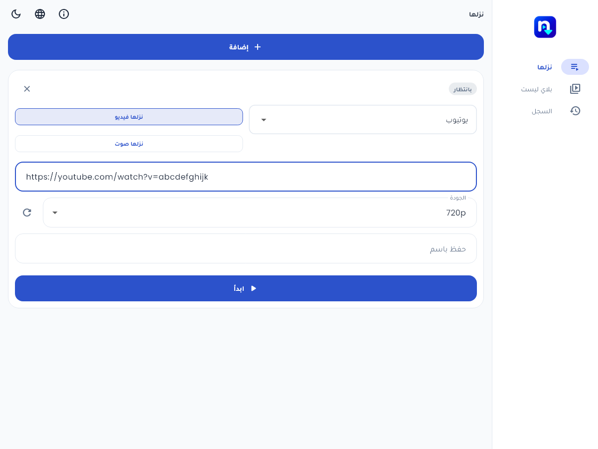
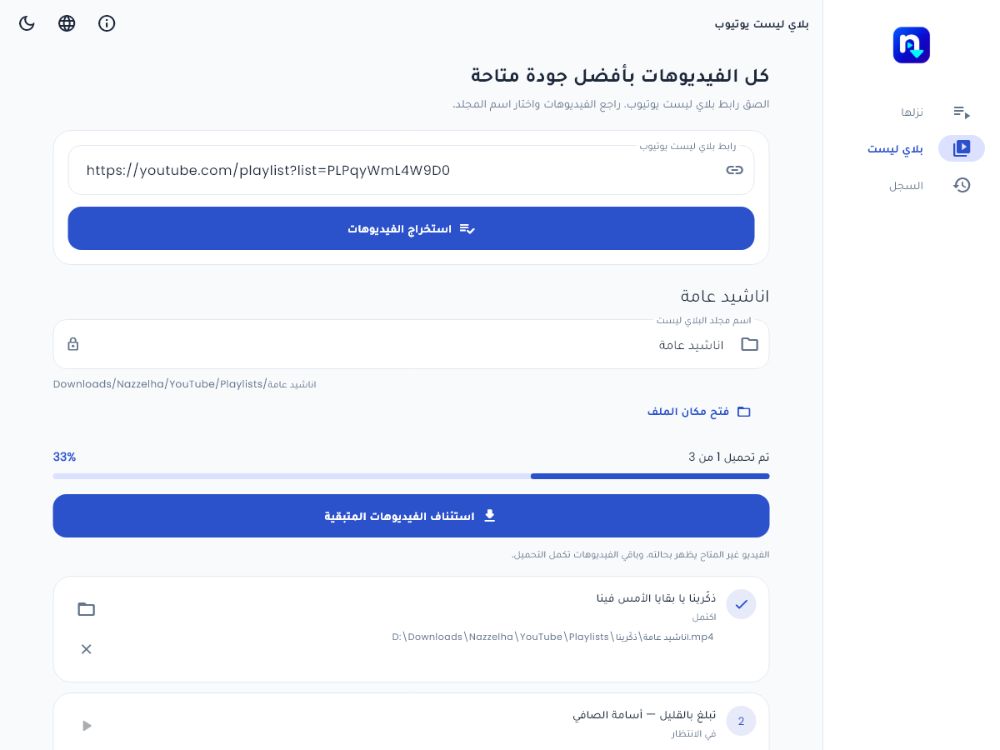
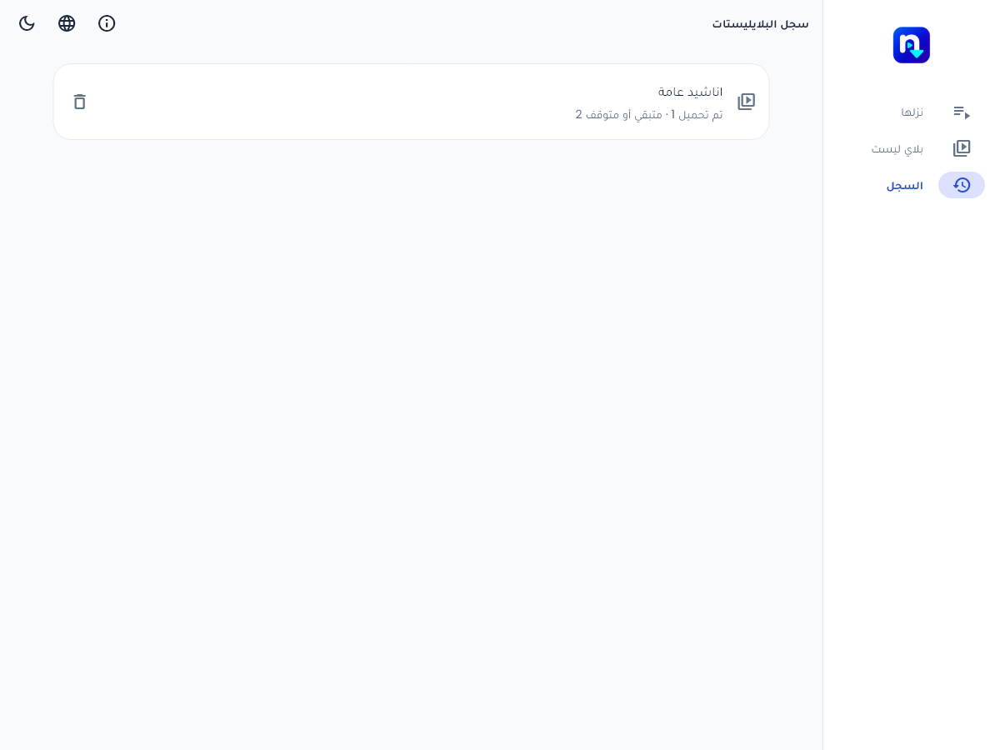
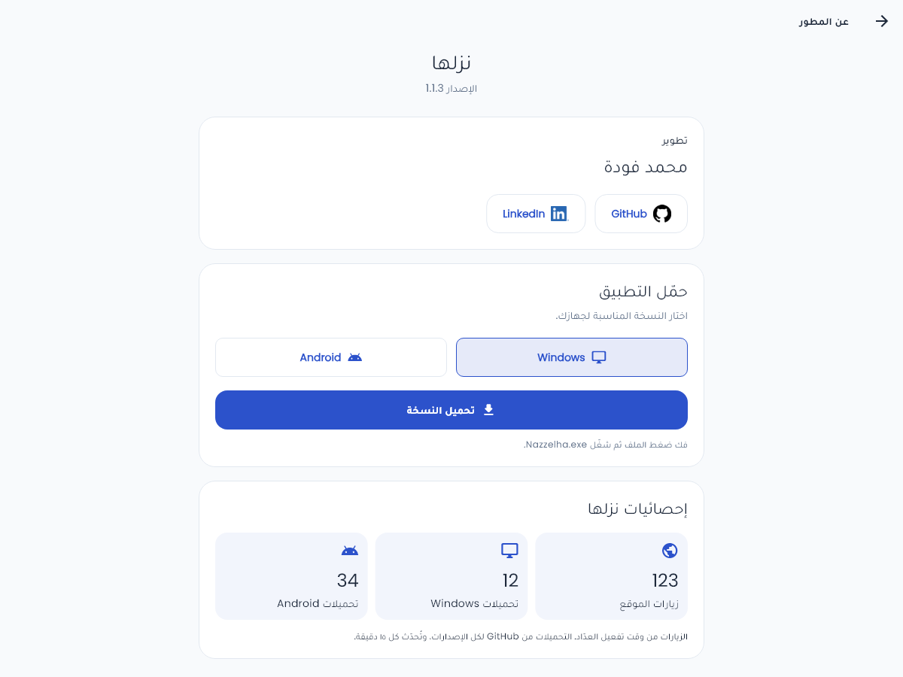

# نزلها — دليل الاستخدام

نزلها يجمع تنزيل الفيديو والصوت، وطابور الروابط، وبلايليست يوتيوب في واجهة واحدة بالعربية والإنجليزية. تختار الرابط والجودة واسم الملف، أو تختار مجلدًا لبلايليست كاملة وتتابع كل فيديو منفصلًا.

[الموقع الرسمي](https://nazzelha.mohamed-fooda-mtf.workers.dev/) · [تحميل التطبيق](https://github.com/MTFOODA/nazzelha/releases/latest) · [الدليل المصور بإشارات الأزرار](guide-ar.html) · [الفيديو المصور](media/Nazzelha-Walkthrough-AR.mp4)

[الديمو الحي لتطبيق Android](media/Nazzelha-Live-Demo-Android.mp4): تسجيل فعلي بسرعة ١٫٧٥×، يشمل روابط فيسبوك ويوتيوب المرسلة. اكتمل تنزيل فيسبوك وفيديوهين من القائمة في مجلد «اناشيد عامة Demo»، واستُبعد الثالث عمدًا لعرض زر الإزالة. فُحصت الملفات كاملةً بـFFmpeg دون أخطاء.

## الأجهزة والإصدارات

| النسخة | طريقة الاستخدام | حالة الدعم |
| --- | --- | --- |
| Android | ملف APK واحد لمعالجات ARM وARM64 وx86_64 | الحد الأدنى Android 7 / API 24. اختُبر التثبيت والترقية على Android 7 و17؛ لم يُختبر كل إصدار بينهما منفصلًا. |
| Windows x64 | فك ضغط ZIP كاملًا، ثم تشغيل `nazzelha.exe` | محرك Python وFFmpeg وNode مرفق؛ لا تحتاج تثبيتها لتشغيل النسخة المنشورة. |
| الويب | فتح الموقع في المتصفح | واجهة عامة مع خدمة تجهيز ملفات مجانية؛ اختُبرت على Edge. |
| iPhone / iPad | الموقع، أو نسخة iOS 15+ التجريبية بتوقيع شخصي | [دليل IPA وSideloadly](IOS_PREVIEW_AR.md). تستخدم النسخة الأصلية محرك الاستضافة؛ التثبيت على هاتف فعلي ينتظر التحقق. |
| Linux / macOS | — | لا توجد إصدارات أصلية منشورة ومتحقق منها. |

الدعم المتعدد هنا يعني Android وWindows والويب، وليس وجود تطبيق أصلي لكل نظام. تنزيل الخلفية على Android يخص التطبيق المثبت؛ لا يضمن المتصفح استمرار العمل عند إغلاق الصفحة أو إيقافها بواسطة النظام.

## التنقل والهيدر

| الزر | وظيفته |
| --- | --- |
| نزلها | فتح طابور الروابط الفردية. |
| بلاي ليست | استخراج وتنزيل بلايليست من YouTube فقط. |
| السجل | عرض البلايليستات السابقة بأسمائها وعدد المكتمل والمتبقي أو المتوقف. |
| ⓘ عن المطور | اسم المطور، روابط GitHub وLinkedIn، تنزيل النسخ والإحصائيات. |
| الكرة الأرضية | التبديل بين العربية والإنجليزية، مع تغيير اتجاه الواجهة. |
| القمر / الشمس | التبديل بين الوضع الداكن والفاتح. |
| سهم الرجوع | الرجوع من صفحة المطور أو تفاصيل بلايليست إلى الشاشة السابقة. |

على الشاشة الواسعة يظهر التنقل في جانب التطبيق، وعلى الموبايل يظهر في الأسفل. ترتيب العناصر يتبع لغة الواجهة.

## نزلها: كل عناصر كارت التنزيل

| العنصر | ما الذي يفعله؟ |
| --- | --- |
| إضافة + | إضافة كارت مستقل لرابط آخر. |
| اختيار المنصة | اختيار YouTube أو Facebook أو Instagram أو TikTok. يجب أن يتوافق الاختيار مع الرابط. |
| نزلها فيديو | تنزيل الفيديو مع الصوت عندما يكون متاحًا في المصدر. |
| نزلها صوت | طلب تنزيل الصوت؛ تختفي قائمة جودة الفيديو في هذا الوضع. |
| حقل الرابط | لصق رابط الفيديو الكامل. روابط المشاركة المدعومة يمكن استخدامها مباشرة. |
| الجودة | اختيار أفضل جودة متاحة أو دقة محددة للكارت. لا يستطيع التطبيق إنشاء دقة أعلى من المصدر. |
| سهم التحديث بجانب الجودة | استخراج الجودات المتاحة للرابط. ليس زر إعادة تحميل الصفحة. |
| حفظ باسم | اسم اختياري للملف. تركه فارغًا يستخدم الاسم المستخرج من المصدر. |
| ابدأ | التحقق من المدخلات وإضافة المهمة إلى التنفيذ. تعمل مهام الطابور بالتتابع. |
| استئناف | إعادة محاولة المهمة المتوقفة أو الفاشلة. إمكانية استكمال نفس البايتات تعتمد على المصدر والملف الجزئي؛ ليست مضمونة لكل منصة. |
| × إزالة | إزالة الكارت؛ إن كان نشطًا يطلب تأكيد الإلغاء والإزالة. لا يعني ذلك حذف ملف مكتمل من جهازك. |
| الحالة وشريط التقدم | بيان الانتظار أو العمل أو الدمج أو الاكتمال أو الفشل؛ بعض المصادر لا تعطي حجمًا إجماليًا دقيقًا. |
| فتح مكان الملف | يظهر بعد اكتمال التنزيل في التطبيق المثبت، ويفتح موقع الملف عبر مدير الملفات المتاح. |
| حفظ على جهازك | المقابل في الويب: حفظ الملف الذي تم تجهيزه داخل المتصفح. «جاهز للحفظ» لا تعني أنك حفظته بالفعل على القرص. |

تُعطّل بعض الحقول أثناء عمل المهمة لحماية بياناتها من التغيير أثناء التنزيل.

فتح المجلد يعتمد أيضًا على مدير الملفات في الجهاز. في Android 7 وبعض مديري
الملفات القديمة، قد يبدأ المنتقي من «الأخيرة» بدل المجلد المحدد؛ انتقل إلى
التنزيلات ثم `Nazzelha` والمنصة. النظام القديم لا يدعم تلميح مجلد البداية
المتوفر في الإصدارات الأحدث. تنزيل الملفات نفسه يستمر ويكتمل مستقلًا عن ذلك.

### مثال Facebook المستخدم في التحقق

1. أضف كارتًا واختر Facebook ثم «نزلها فيديو».
2. الصق [رابط المثال العام](https://www.facebook.com/share/v/14ub8NMwKXx/).
3. اترك الجودة «أفضل جودة متاحة»، واكتب اسمًا اختياريًا، ثم «ابدأ».
4. في تطبيق Android وافق على إذن الملفات أو الإشعارات عندما يطلبه النظام للتنزيل.
5. بعد الاكتمال اضغط «فتح مكان الملف»؛ في الويب اضغط «حفظ على جهازك».

هذا المثال اكتمل فعلًا في خلفية تطبيق Android 7 بعد إصلاح تواصل Python مع نسخة الريليس. كانت هناك محاولة بخطأ TLS عابر، ثم نجح «استئناف». قابلية فتح الرابط مستقبلًا تتبع الناشر والمنصة.

الرابطان [مثال المشاركة الثاني](https://www.facebook.com/share/v/1EBbdjoJqM/) و[رابط الفيديو المباشر](https://www.facebook.com/zhrtalaml344/videos/1124975946568625/) يحتاجان وصولًا يتيحه حساب المستخدم. فتح فيديو داخل حساب Facebook لا يثبت أنه قابل للتنزيل العام في التطبيق. رسالة القيد من الناشر لا تحدد وحدها السبب التقني لكل خطأ؛ قد توجد أيضًا أخطاء اتصال أو قيود من المنصة.

## بلايليست YouTube

| العنصر | وظيفته |
| --- | --- |
| رابط بلاي ليست يوتيوب | رابط يحتوي على معرف `list`؛ هذا القسم لا يقبل بلايليست منصات أخرى. |
| استخراج الفيديوهات | قراءة عنوان القائمة وعناصرها قبل بدء التنزيل. |
| اسم مجلد البلاي ليست | تخصيص اسم المجلد، بما في ذلك الأسماء العربية. اختره قبل بدء التنزيل. |
| علامة القفل بجانب الاسم | يظهر القفل أثناء العمل أو بعد وجود ملفات مكتملة، حتى تستقر وجهة بقية الفيديوهات. |
| المسار / اسم ZIP | يعرض المجلد المقصود في التطبيق أو اسم حزمة الحفظ في الويب. |
| تحميل الكل · أفضل جودة | بدء تنزيل العناصر المتاحة بأفضل جودة يتيحها المصدر والمحرك. |
| إيقاف مؤقت | طلب إيقاف العمل الحالي. يمكن العودة لاحقًا إلى العناصر المتبقية. |
| استئناف الفيديوهات المتبقية | متابعة العناصر غير المكتملة دون إعادة تنزيل المكتمل. |
| زر ▶ بجانب فيديو | إعادة محاولة هذا العنصر وحده عندما يكون التحكم متاحًا. |
| زر × بجانب فيديو | استبعاده من المهمة؛ لا يفرض تنزيل فيديو لا تريده. |
| أيقونة المجلد بجانب المكتمل | فتح مكان هذا الملف في التطبيق، أو حفظه على الجهاز في الويب. |
| فتح مكان الملف للقائمة | فتح وجهة البلايليست في التطبيق المثبت. |
| حفظ البلايليست ZIP | تجميع الملفات الجاهزة في حزمة للزائر في الويب، ضمن حدود الحجم. |
| العدد والنسبة | عدد العناصر المكتملة والتقدم الإجمالي. العنصر غير المتاح يعرض حالته منفصلًا. |

مثال القائمة المرسل للاختبار: [اناشيد عامة](https://youtube.com/playlist?list=PLPqyWmL4W9D0). أرجع استخراجها ثلاثة عناصر وقت التحقق. المسار المعتاد: `Downloads/Nazzelha/YouTube/Playlists/<اسم المجلد>`.

في Android، خدمة تنزيل أمامية بإشعار تتولى العمل خارج شاشة Flutter. ينبغي إبقاء الجهاز متصلًا بالإنترنت؛ الإيقاف القسري للتطبيق أو قيود البطارية من النظام قد يوقفان الخدمة. تبقى الملفات المكتملة، ويمكن استئناف المتبقي من السجل.

## سجل البلايليستات

- اضغط بطاقة باسم البلايليست لفتح تفاصيلها والتحكم في عناصرها.
- العدد المكتمل يخص الفيديوهات المكتملة؛ المتبقي أو المتوقف يضم العناصر غير المكتملة التي ما زالت في القائمة.
- أيقونة سلة المهملات تزيل السجل بعد التأكيد، وتبقي الفيديوهات التي نُزّلت على الجهاز.
- لا توجد هنا قائمة مستقلة بكل فيديو فردي؛ هذه الشاشة مخصصة لسجل البلايليستات.

## عن المطور والتنزيل والإحصائيات

| الزر أو البيان | وظيفته |
| --- | --- |
| GitHub | فتح بروفايل المطور Mohamed Fooda. |
| LinkedIn | فتح بروفايل المطور على LinkedIn. |
| Windows / Android | اختيار ملف النسخة المناسبة؛ الاختيار وحده لا يبدأ التنزيل. |
| تحميل النسخة | فتح الملف المحدد من أحدث إصدار رسمي على GitHub Releases. |
| زيارات الموقع | جلسات زيارة مدتها 30 دقيقة؛ ليست عدد أشخاص فريدين مثبتًا. |
| تحميلات Windows | مرات تنزيل ملف ZIP الرسمي من الإصدارات العامة المستقرة. |
| تحميلات Android | مرات تنزيل ملف APK الرسمي من الإصدارات العامة المستقرة، وليست عدد مرات التثبيت. |

الأعداد تتحدث كل 15 دقيقة؛ الشرطـة تعني عدم توافر العدد. أرقام صور الشرح بيانات عرض وليست إحصائيات الموقع الحية. [تفاصيل طريقة العد](STATISTICS.md).

## نقاط قوة نزلها

يجمع المشروع اختيار الجودة لكل كارت، وحفظ الأسماء العربية، ومجلدات البلايليست، والاستئناف والاستبعاد لكل عنصر، وسجل القوائم، وخدمة Android الخلفية، ومحرك Windows المرفق، وواجهة ويب عامة، والترجمة والوضعين في تجربة واحدة. هذه مميزات موجودة ومثبتة في المشروع، وليست ادعاءً بأن كل ميزة حصرية أو غائبة عن جميع التطبيقات المنافسة.

## حدود الويب والأخطاء الشائعة

- الويب المجاني يحد الفيديو بحوالي 96 MiB وزمن التجهيز والنقل بـ225 ثانية. الحد لحزمة ZIP هو 128 MiB، وإجمالي الملفات المؤقتة في المتصفح 256 MiB، وصلاحيتها نحو ساعة أو حتى إعادة تحميل الصفحة.
- اترك الصفحة مفتوحة أثناء التجهيز واحفظ الملفات قبل إغلاقها. السجل المحفوظ لا يستعيد ملفًا مؤقتًا فقده المتصفح.
- قد يرفض YouTube طلبات الوسائط من شبكة الاستضافة رغم نجاح استخراج قائمة الفيديوهات. استخدم التطبيق المثبت عندما تواجه هذا القيد.
- إذا رفض Android تثبيت APK، أعد تنزيله من الإصدار الرسمي وقارن SHA-256. الملف القديم التالف على جهاز الاختبار فشل في فحص سلامة التوقيع، بينما نجحت إعادة التنزيل.
- لا يتجاوز التطبيق خصوصية الناشر أو قيود تسجيل الدخول. تعطل مصدر أو رابط لا يعني أن جميع المنصات توقفت.

## نتائج التحقق

راجع [توثيق التوافق والتثبيت](ANDROID_INSTALLATION.md) و[ملخص التحقق القابل للقراءة آليًا](verification-1.1.3.json). صور الدليل لقطات واجهة ببيانات توضيحية، وليست إثباتًا مستقلًا لنجاح تنزيل كل عنصر ظاهر فيها. [مصدر الفيديو وحدوده](DEMO.md).
